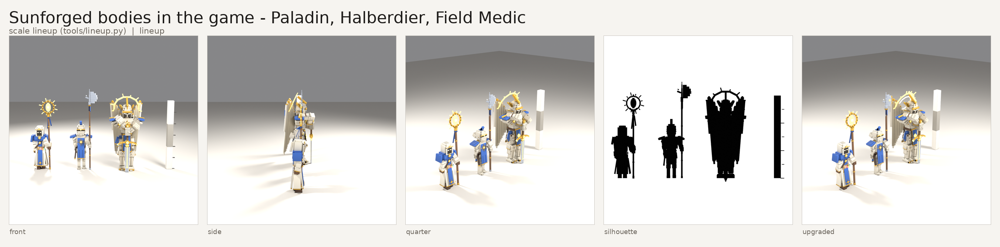
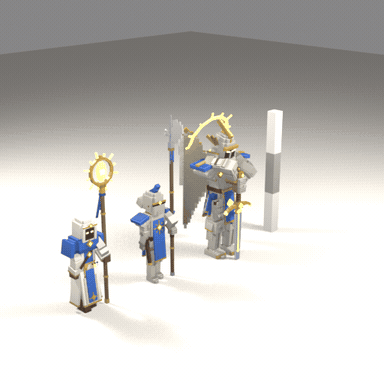
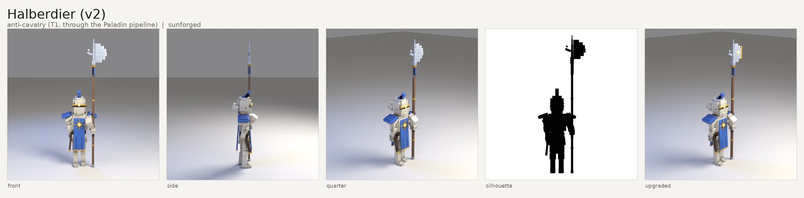
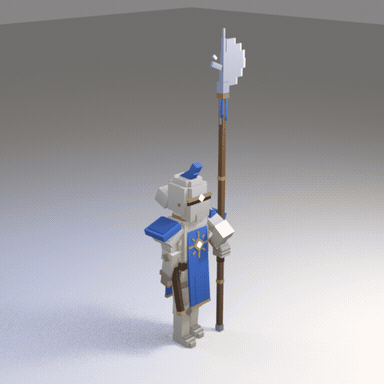

# Concept sheets from d09c04a

Rendered by `.github/workflows/concepts.yml` (Blender 4.2.3, CPU only) from `design/models/*.json`. Per model: `sheet.png` (front, side, three-quarter, silhouette, and `upgraded` for a model with upgrade tags), the renders, `turntable.gif` and the `model.json` it was built from.

## Sunforged bodies in the game - Paladin, Halberdier, Field Medic - scale lineup (tools/lineup.py) (lineup)

turntable: EEVEE (llvmpipe). Files:

- [front.png](sunforged_bodies_oct14/front.png)
- [model.json](sunforged_bodies_oct14/model.json)
- [quarter.png](sunforged_bodies_oct14/quarter.png)
- [sheet.png](sunforged_bodies_oct14/sheet.png)
- [side.png](sunforged_bodies_oct14/side.png)
- [silhouette.png](sunforged_bodies_oct14/silhouette.png)
- [turntable-engine.txt](sunforged_bodies_oct14/turntable-engine.txt)
- [turntable.gif](sunforged_bodies_oct14/turntable.gif)
- [upgraded.png](sunforged_bodies_oct14/upgraded.png)

## Halberdier (v2) - anti-cavalry (T1, through the Paladin pipeline) (sunforged)

turntable: EEVEE (llvmpipe). Files:

- [front.png](sunforged_halberdier_v2/front.png)
- [model.json](sunforged_halberdier_v2/model.json)
- [quarter.png](sunforged_halberdier_v2/quarter.png)
- [sheet.png](sunforged_halberdier_v2/sheet.png)
- [side.png](sunforged_halberdier_v2/side.png)
- [silhouette.png](sunforged_halberdier_v2/silhouette.png)
- [turntable-engine.txt](sunforged_halberdier_v2/turntable-engine.txt)
- [turntable.gif](sunforged_halberdier_v2/turntable.gif)
- [upgraded.png](sunforged_halberdier_v2/upgraded.png)
