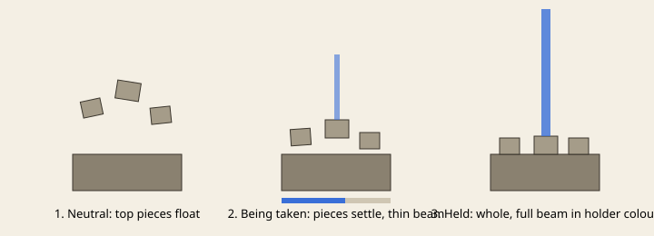
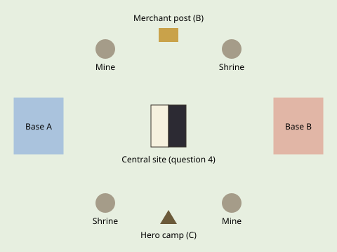

# Neutral objectives (C6): design page

Status: **draft for lovish's yes.** Nothing below is built yet. Lane C (BAC-012), 2026-11-04.
Source: design/HANDOFF-lane-c.md C6 ("capturable points as floating ruins that reassemble when held (beams in the
holder's colour), giving map control advantages (e.g. a refinery or a tower); later merchant posts and hero jungle
camps"); lovish, Oct 10: "buildings that can be captured that can provide helpful benefits or units or an advantage".

## 1. What is already on main (do not redo)
`startpos/CapturePointServerEvents`: a site is taken by keeping units within 6 blocks with no enemy there for 20 s; an
enemy alone drains it to neutral first. Nine kinds:

| Kind | Gives the holder | Where |
|---|---|---|
| Ancient Mine | +3 metal/s | random ring + maps |
| Ley Shrine | +30 energy/s | random ring + maps |
| Mercenary Camp | a hired wolf every 60 s, max 3 | random ring + maps |
| Sunken Bell / Watchtower | 40 / 64 blocks of vision | maps only |
| Ancient Forge | research and upgrades 25% cheaper | maps only |
| Lava Vent | +45 energy/s | maps only |
| Oasis | heals own units within 12 (2 hp/s) | maps only |
| Forsaken Garrison | musters the map's recruit (90 s, max 2) | maps only |

The ruin is ordinary blocks in the map's style; only its crown wool takes the owner's colour.
C6's "refinery" is the Mine/Shrine/Vent family and its "tower" is the Watchtower, so **no new economy kinds are proposed**.
What C6 still lacks is how a held point *looks and reads*, plus two new kinds of site.

## 2. Proposal A: ruins that rebuild while held (the look)

- **Neutral:** the ruin's top blocks float 1-3 blocks above their places, broken off, turning slowly (block display
  entities, client only). The base stays real blocks, so pathing and the 6-block capture circle do not change.
- **Being taken (0-20 s):** the floating pieces drift down into place in step with capture progress, and a thin beam
  in the claimant's colour rises from the crown. A contested site (an enemy inside) shakes and stops moving.
- **Held:** the ruin is whole, the beam is full height in the holder's colour, and it can be seen through the fog as a
  minimap pip, so every player can read who holds the map.
- **Lost / drained:** the pieces lift off again as the progress bar falls.
- Cost: display entities only near the camera; the beam is one quad. It must pass the 300-unit frame budget (N1/N5).

## 3. Proposal B: merchant posts (new kind)
- A small trading stall, held like any site. While held, its owner can **trade 100 metal for 1000 energy, or the reverse,
  at a 25% loss**, with one trade per 30 s. That gives a stalled economy a way out without a new resource.
- Look: a storybook market stall (striped awning, crates, a hanging lantern), in the map's style palette.
- Maps only at first (one per map, in the middle lane), so the random ring keeps its three kinds.

## 4. Proposal C: hero camps (new kind, after the hero work settles)
- A neutral camp of 3-5 creatures that do not move until attacked. Clearing it gives the killing player's hero XP and
  a one-off pickup (for example 150 metal). It respawns after 3 minutes. It is not a capture point and has no owner.
- It rewards heroes moving round the map between fights. It waits for the hero XP and arena work in open PR #488.

## 5. The central objective (question for lovish)

The proposal list (notes/proposals-bac-b-next.md N4) also names "the split light/dark central cathedral". I found no
design text for it in design/. If it is lovish's idea, one reading is a large central site with two halves, each held
separately: one half shows lit glass and the other is dark, and the holder of both gets a bonus (for example both
Bell vision and Forge discount). **This needs lovish's description before any design is written.**

## 6. Order of work after a yes
1. A (the look) on the existing nine kinds: client only, low risk, eyes stills before and after.
2. B (merchant post): server rule plus a GameTest (trade rate, cooldown, owner only), and one map placement.
3. C (hero camps): after #488.

## 7. Open questions for lovish
1. Floating ruins: is the look in section 2 the one you meant, and should the beam be seen through the fog?
2. Merchant post trade: is 100 metal for 1000 energy at a 25% loss, one trade per 30 s, the right size?
3. Hero camps: wanted, and if so on which maps?
4. The central cathedral: what did you have in mind?
